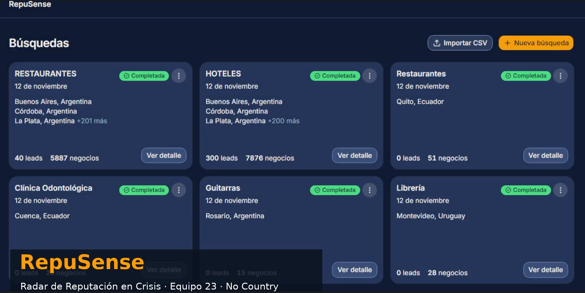
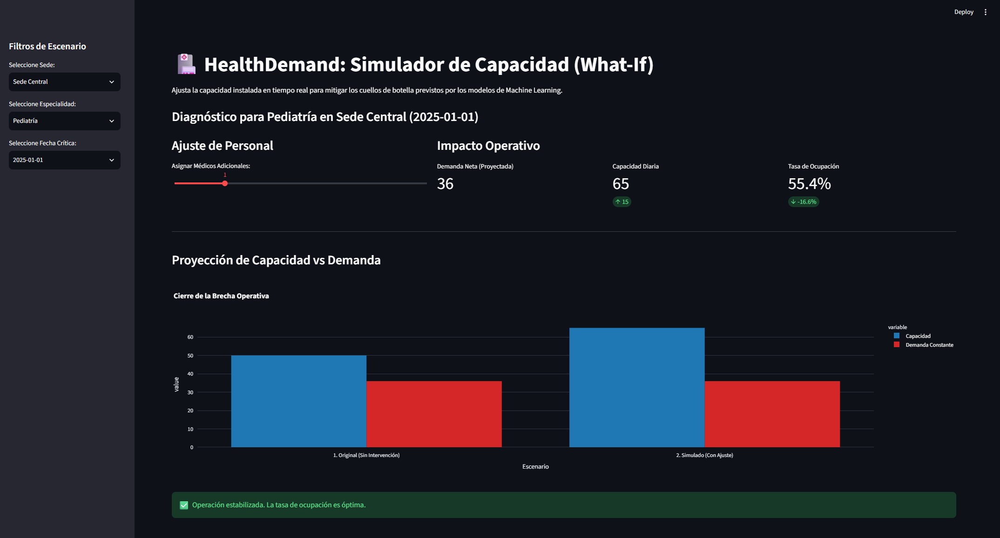

  <a href="https://github.com/joseariasduran/joseariasduran/blob/main/README.md">🇪🇸 ESP</a> | <a href="https://github.com/joseariasduran/joseariasduran/blob/main/README-en.md">🇬🇧 ENG</a>

<!-- TOP BANNER: Upload a 1200x300px image to /assets/banner.png with background #0D1117 -->
<!-- If you don't have the banner yet, you can comment out the following block -->

  

/h3>

  
  
  
  

---

### 💡 Value Proposition

With **10+ years of operational leadership** across the automotive, motorcycle, and agricultural machinery industries (Nissan, Honda, New Holland), I bridge real-world business operations with advanced analytics. I transform complex operational and commercial data into **BI architectures, executive dashboards, and predictive models** that reduce costs, optimize capacity, and maximize customer retention.

<table>
  <tr>
    <td width="33%" valign="top">
      <h4>📊 Business Intelligence</h4>
      
Dimensional modeling (Star Schema), advanced <b>DAX</b> measures, ETL pipelines in <b>Power Query/SQL</b>, and executive storytelling in <b>Power BI</b>.

    </td>
    <td width="33%" valign="top">
      <h4>🤖 Data Science & GenAI</h4>
      
Classification and time-series forecasting models (<b>XGBoost, LightGBM</b>), risk simulation, <i>web scraping</i>, and NLP extraction with <b>LLMs (Gemini)</b>.

    </td>
    <td width="33%" valign="top">
      <h4>⚙️ Operations & Processes</h4>
      
Industrial Engineering applied to after-sales KPIs, inventory optimization, warranty management, and loyalty strategies (<b>Churn & LTV</b>).

    </td>
  </tr>
</table>

---

### 🚀 Featured Projects Showcase

<table>
  <!-- PROJECT 1 -->
  <tr>
    <td width="45%" align="center">
      
    </td>
    <td width="55%" valign="top">
      <h3>🎯 RepuSense — B2B Lead & Reputation Intelligence</h3>
      
<b>Problem:</b> Sales teams spend hours manually analyzing the digital reputation of B2B prospects. 
      <b>Solution:</b> Automated pipeline that scrapes business listings and reviews, detects operational pain points using <b>Gemini AI</b>, and drafts personalized cold outreach emails.

      

        <code>Python</code> <code>Web Scraping</code> <code>Gemini AI</code> <code>PostgreSQL</code> <code>NestJS</code> <code>React</code>
      

      

        <a href="https://github.com/No-Country-simulation/S10-26-equipo-23"><b>🔗 View Repository</b></a>
      

    </td>
  </tr>

  <!-- PROJECT 2 -->
  <tr>
    <td width="45%" align="center">
      
    </td>
    <td width="55%" valign="top">
      <h3>🏥 HealthDemand — Medical Capacity & No-Show Prediction</h3>
      
<b>Problem:</b> Patient no-shows create idle time and lost installed capacity in healthcare clinics. 
      <b>Solution:</b> Hybrid system featuring <i>No-Show</i> classification (<b>XGBoost</b>) and demand forecasting (<b>LightGBM</b>), integrated with an executive <b>Power BI</b> dashboard and <b>Streamlit</b> simulator.

      

        <code>Power BI</code> <code>DAX</code> <code>Python</code> <code>XGBoost</code> <code>LightGBM</code> <code>Streamlit</code>
      

      

        <a href="https://github.com/joseariasduran"><b>🔗 View Repository</b></a>
      

    </td>
  </tr>

  <!-- PROJECT 3 -->
  <tr>
    <td width="45%" align="center">
      
    </td>
    <td width="55%" valign="top">
      <h3>🖥️ AI Data Center — Stranded Capacity Estimation</h3>
      
<b>Problem:</b> AI infrastructure faces financial risks due to underutilized power and compute capacity. 
      <b>Solution:</b> Analytical risk model and interactive executive calculator deployed via API to simulate utilization scenarios.

      

        <code>Python</code> <code>Risk Analysis</code> <code>FastAPI</code> <code>Streamlit</code> <code>Docker</code>
      

      

        <a href="https://github.com/joseariasduran"><b>🔗 View Repository</b></a>
      

    </td>
  </tr>

  <!-- PROJECT 4 -->
  <tr>
    <td width="45%" align="center">
      
    </td>
    <td width="55%" valign="top">
      <h3>🚗 AutoSmart-Retention — Automotive Churn Prediction</h3>
      
<b>Impact:</b> <b>88% accuracy</b> identifying customers at risk of attrition in automotive after-sales services. 
      <b>Solution:</b> Machine Learning pipeline translating maintenance and billing patterns into actionable retention alerts.

      

        <code>Python</code> <code>Scikit-Learn</code> <code>XGBoost</code> <code>Customer Analytics</code>
      

      

        <a href="https://github.com/joseariasduran/AutoSmart-Retention"><b>🔗 View Repository</b></a>
      

    </td>
  </tr>
</table>

  
<b>📂 View More Data Science & Time-Series Projects (Click to expand)</b>

   
  <table>
    <tr>
      <th>Project</th>
      <th>Focus & Results</th>
      <th>Stack</th>
    </tr>
    <tr>
      <td>🚖 <a href="https://github.com/joseariasduran/Sweet-Lift-Taxi"><b>Sweet Lift Taxi</b></a></td>
      <td>Hourly airport taxi demand forecasting (<b>RMSE &lt; 48</b>) to optimize fleet logistics during peak hours.</td>
      <td>Python, LightGBM, Random Forest, Time Series</td>
    </tr>
    <tr>
      <td>🛢️ <a href="https://github.com/joseariasduran/OilyGiant"><b>OilyGiant</b></a></td>
      <td>Selection of 200 optimal oil well locations using <i>bootstrapping</i> to minimize financial risk and maximize net profit.</td>
      <td>Python, Bootstrapping, Simulation</td>
    </tr>
    <tr>
      <td>🥇 <a href="https://github.com/joseariasduran/Gold-Recovery"><b>Gold Recovery</b></a></td>
      <td>Gold concentration estimation across mining purification stages to optimize operational parameters.</td>
      <td>Python, Advanced Regression, EDA</td>
    </tr>
  </table>

---

### 🛠️ Core Tech Stack

| Category | Tools & Technologies |
| :--- | :--- |
| **BI & Visualization** |        |
| **Databases** |    |
| **Data Science & AI** |        |
| **APIs & Workflow** |      |

---

### 🎓 Education & Community

* **B.S. in Industrial and Systems Engineering** — Instituto Tecnológico de Sonora (ITSON)
* **Data Science & Business Analytics** — TripleTen LatAm
* **Active Member** — Google Developer Program

---

### 📊 GitHub Activity

  
  

