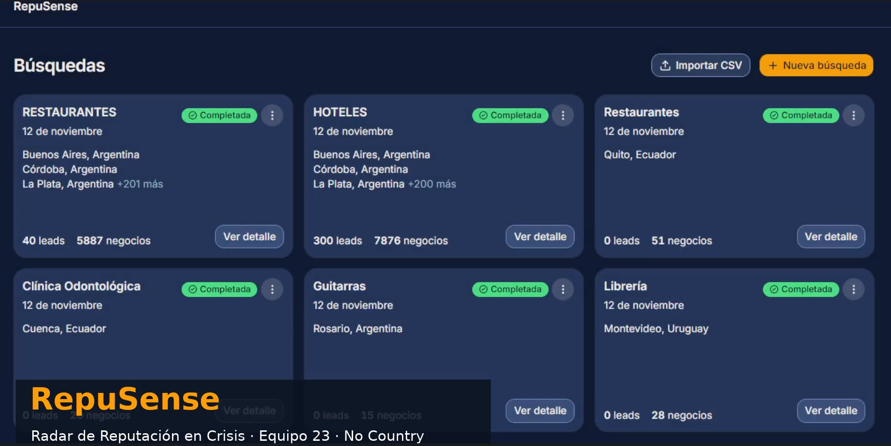
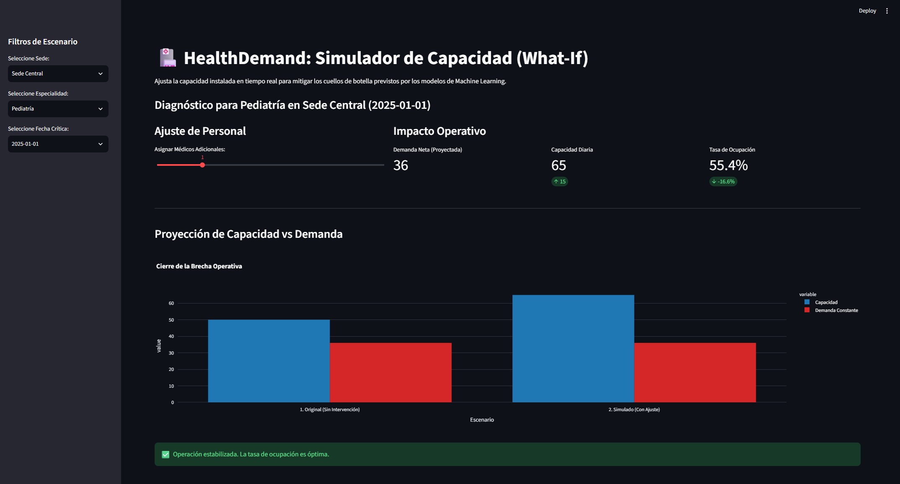

  <a href="https://github.com/joseariasduran/joseariasduran/blob/main/README.md">🇪🇸 ESP</a> | <a href="https://github.com/joseariasduran/joseariasduran/blob/main/README-en.md">🇬🇧 ENG</a>

<!-- BANNER SUPERIOR: Sube una imagen de 1200x300px a /assets/banner.png con fondo #0D1117 -->
<!-- Si aún no tienes el banner, puedes comentar la siguiente línea -->

  

<h1 align="center">José de Jesús Arias Durán</h1>

<h3 align="center">Business Intelligence Analyst • Data Scientist • Industrial & Systems Engineer</h3>

  
  
  
  

---

### 💡 Propuesta de Valor

Con **más de 10 años de liderazgo operacional** en las industrias automotriz, motocicletas y maquinaria agrícola (Nissan, Honda, New Holland), combino visión real de negocio con analítica avanzada. Transformo datos operativos y comerciales complejos en **arquitecturas de BI, tableros ejecutivos y modelos predictivos** que reducen costos, optimizan capacidad y maximizan la retención de clientes.

<table>
  <tr>
    <td width="33%" valign="top">
      <h4>📊 Business Intelligence</h4>
      
Modelado dimensional (Star Schema), medidas avanzadas en <b>DAX</b>, pipelines ETL en <b>Power Query/SQL</b> y storytelling ejecutivo en <b>Power BI</b>.

    </td>
    <td width="33%" valign="top">
      <h4>🤖 Data Science & GenAI</h4>
      
Modelos de clasificación y series temporales (<b>XGBoost, LightGBM</b>), simulación de riesgos, <i>web scraping</i> y análisis NLP con <b>LLMs (Gemini)</b>.

    </td>
    <td width="33%" valign="top">
      <h4>⚙️ Operaciones & Procesos</h4>
      
Ingeniería Industrial aplicada a KPIs de posventa, optimización de inventarios, control de garantías y estrategias de fidelización (<b>Churn & LTV</b>).

    </td>
  </tr>
</table>

---

### 🚀 Vitrina de Proyectos Destacados

<table>
  <!-- PROYECTO 1 -->
  <tr>
    <td width="45%" align="center">
      
    </td>
    <td width="55%" valign="top">
      <h3>🎯 RepuSense — B2B Lead & Reputation Intelligence</h3>
      
<b>Problema:</b> Equipos comerciales invierten horas analizando manualmente la reputación digital de prospectos B2B. 
      <b>Solución:</b> Pipeline automatizado que extrae reseñas y fichas de negocios, detecta puntos de dolor operativos mediante <b>Gemini AI</b> y redacta correos personalizados de primer contacto.

      

        <code>Python</code> <code>Web Scraping</code> <code>Gemini AI</code> <code>PostgreSQL</code> <code>NestJS</code> <code>React</code>
      

      

        <a href="https://github.com/No-Country-simulation/S10-26-equipo-23"><b>🔗 Ver Repositorio</b></a>
      

    </td>
  </tr>

  <!-- PROYECTO 2 -->
  <tr>
    <td width="45%" align="center">
      
    </td>
    <td width="55%" valign="top">
      <h3>🏥 HealthDemand — Capacidad Médica y Predicción No-Show</h3>
      
<b>Problema:</b> El ausentismo de pacientes genera tiempos muertos y pérdida de capacidad instalada en clínicas. 
      <b>Solución:</b> Sistema híbrido con clasificación de <i>No-Show</i> (<b>XGBoost</b>) y pronóstico de demanda (<b>LightGBM</b>), conectado a un tablero ejecutivo en <b>Power BI</b> y simulador en <b>Streamlit</b>.

      

        <code>Power BI</code> <code>DAX</code> <code>Python</code> <code>XGBoost</code> <code>LightGBM</code> <code>Streamlit</code>
      

      

        <a href="https://github.com/joseariasduran"><b>🔗 Ver Repositorio</b></a>
      

    </td>
  </tr>

  <!-- PROYECTO 3 -->
  <tr>
    <td width="45%" align="center">
      
    </td>
    <td width="55%" valign="top">
      <h3>🖥️ AI Data Center — Estimación de Capacidad Varada</h3>
      
<b>Problema:</b> Infraestructuras de IA enfrentan riesgos financieros por capacidad energética y de cómputo subutilizada. 
      <b>Solución:</b> Modelo analítico de riesgo y calculadora ejecutiva interactiva desplegada vía API para simular escenarios de ocupación.

      

        <code>Python</code> <code>Risk Analysis</code> <code>FastAPI</code> <code>Streamlit</code> <code>Docker</code>
      

      

        <a href="https://github.com/joseariasduran"><b>🔗 Ver Repositorio</b></a>
      

    </td>
  </tr>

  <!-- PROYECTO 4 -->
  <tr>
    <td width="45%" align="center">
      
    </td>
    <td width="55%" valign="top">
      <h3>🚗 AutoSmart-Retention — Predicción de Churn Automotriz</h3>
      
<b>Impacto:</b> <b>88% de precisión</b> identificando clientes en riesgo de abandono en servicios de posventa automotriz. 
      <b>Solución:</b> Pipeline de Machine Learning que traduce patrones de mantenimiento y facturación en alertas accionables para retención.

      

        <code>Python</code> <code>Scikit-Learn</code> <code>XGBoost</code> <code>Customer Analytics</code>
      

      

        <a href="https://github.com/joseariasduran/AutoSmart-Retention"><b>🔗 Ver Repositorio</b></a>
      

    </td>
  </tr>
</table>

  
<b>📂 Ver más proyectos de Data Science & Series Temporales (Click para desplegar)</b>

   
  <table>
    <tr>
      <th>Proyecto</th>
      <th>Enfoque y Resultado</th>
      <th>Stack</th>
    </tr>
    <tr>
      <td>🚖 <a href="https://github.com/joseariasduran/Sweet-Lift-Taxi"><b>Sweet Lift Taxi</b></a></td>
      <td>Pronóstico de demanda horaria de taxis en aeropuertos (<b>RMSE &lt; 48</b>) para optimización de flotas.</td>
      <td>Python, LightGBM, Random Forest, Time Series</td>
    </tr>
    <tr>
      <td>🛢️ <a href="https://github.com/joseariasduran/OilyGiant"><b>OilyGiant</b></a></td>
      <td>Selección de 200 ubicaciones óptimas de pozos mediante <i>bootstrapping</i> para minimizar riesgo financiero.</td>
      <td>Python, Bootstrapping, Simulación</td>
    </tr>
    <tr>
      <td>🥇 <a href="https://github.com/joseariasduran/Gold-Recovery"><b>Gold Recovery</b></a></td>
      <td>Estimación de concentración de oro en etapas de purificación minera para optimizar parámetros operativos.</td>
      <td>Python, Regresión Avanzada, EDA</td>
    </tr>
  </table>

---

### 🛠️ Core Tech Stack

| Categoría | Herramientas y Tecnologías |
| :--- | :--- |
| **BI & Visualización** |        |
| **Bases de Datos** |    |
| **Data Science & IA** |        |
| **APIs & Workflow** |      |

---

### 🎓 Formación y Comunidad

* **Ingeniero Industrial y de Sistemas** — Instituto Tecnológico de Sonora (ITSON)
* **Data Science & Business Analytics** — TripleTen LatAm
* **Miembro Activo** — Google Developer Program

---

### 📊 Actividad en GitHub

  
  

